# Morph Master skill

This skill teaches an AI to build continuous web morphs, where A turns into B with an in-between you can follow, from whatever material the user has: text, SVG icons, multi-part SVG illustrations, cut-out bitmaps, photos, or glTF models. A description alone is also enough. The output is a seekable, reversible, offline HTML page; no After Effects and no video pipeline are needed.

- **For the AI:** start at [SKILL.md](SKILL.md). It diagnoses the material, routes to the matching guide, plans, builds, and verifies with three separate checks.
- **For people:** this page is the tour.

## What it can do (GIF previews; open `npm run dev` for the real, scrubbable thing)

**Scroll-driven pages (M7).** The reader's scroll scrubs the story.

| | |
| --- | --- |
|  | **MM70 · Tempo, a scroll-driven product page** (`pages/tempo/`, 72 KB offline). The headline's weight breathes from hairline to black; its orange o becomes the timer ring; then calendar → done badge → logo; the brand colour floods the page and hands over to the call-to-action. Landscape and portrait have their own layouts. |
| 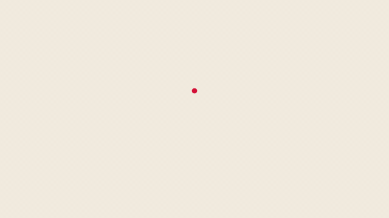 | **MM71 · hum., a motion-logo system cut to music** (`pages/hum/`). A dot becomes a play button, five sound bars that move to the track's real levels, headphones and a mic, then the dot again — every landing on the beat of a 112.9 BPM track, a 16-beat seamless loop, colours turning over on each bar. Exported as 16:9, 1:1 and 9:16 MP4s with the music (the music is the user's, kept local). |
| 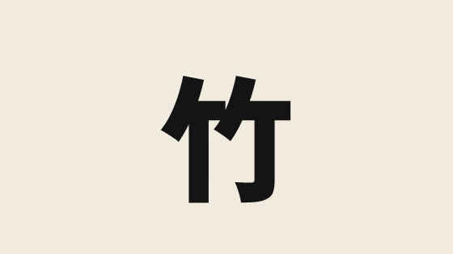 | **MM72 · 竹 → 竹林.** The real 竹 (Noto Sans SC) morphs into a bamboo painting built to look like it: stalks on the 竖, leaves along the 撇 and 横. It still reads as 竹, then the stalks stretch, the leaves gather into 个 clusters, and the camera pulls back while a forest shoots up around it (雨后春笋), paler with distance. It ends on the title and a red seal. |
| 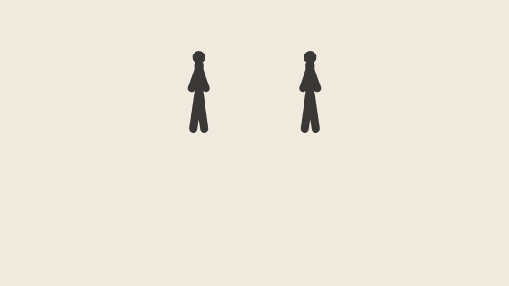 | **MM73 · 俠.** Long shadows creep toward two people far away and they cower. Someone runs in near the camera (big, because he is near: size is depth), plants himself in front of them and throws his arms open. The camera jolts back, the shadows withdraw, and the two look out from under his arms: near big and far small, the ancient 夾. It becomes the real 夾, the line 拥有力量，只是强者；如何使用力量，才决定他能否成为侠。 rolls in, and the 亻 of 他 rises from the sentence to make 俠, which turns seal red. |
|  | **MM74 · A lyric video by rule.** Each line holds two bars. Between lines, the same characters and shared components (辶, 亻, 口…) are found automatically and fly to the next line, flushing red. The donor character visibly loses its piece; the camera flies a route and a dashed route draws behind it. Original placeholder lines; your own lyrics and song can be dropped in locally. |
|  | **MM75 · 创世记 1:1–5 (和合本, public domain).** A faint 水 over still water; the spirit glides across with a ripple on every beat and the reflection trembles. Then "要有光": a point blooms into a hairline 光, gains weight, and its own strokes become the rays of a burst that floods the frame. Dark rises and halves the world (昼 / 夜), the divide turns through evening and morning, and the darkness folds into the 一 of 头一日. |
|  | **MM76 · 道德经 第四十二章.** 道 contracts to a point that draws out 一; 一 splits into 二 and 三 (the font's own rectangles, so every step is the real glyph). 三 is already the trigram ☰: it rises to the top of a ring and the other seven trigrams fan out of it (Fu Xi order, lines breaking into yin); each spreads into eight hexagrams — 万物, the 64 ring — and a taiji grows inside. They turn against each other, return to a point, and 道 returns. |
|  | **MM77 · 道德经 五章 (一、十一、四十二、八、二十五), about 98 s, about 24 effects.** 道 gains weight and shatters along a Voronoi fracture; 名 blows into dust that winds into a double spiral and gathers into 门, and the camera pushes through the door. Thirty spokes lock into a hub around a still hole; the hole becomes a vessel's mouth with liquid clay; door and windows are carved and light falls through with the lattice. 一二三 → hexagrams → taiji (MM76). The ring rains down, the taiji melts into water, and 道 rises with its reflection. 人 in 地 in 天 in 道 in 自然 pull back, and the frame flips tile by tile. |
|  | **MM78 · & — a co-op platformer MV, about 53 s.** A hairline & gains weight and splits into its two letters, E and t (the ampersand is a ligature of "et"), who play through levels of changing dimension. TYPE: the platforms are the sentence TWO CAN GO WHERE ONE CANNOT; E bonks its head on ONE alone, t springs off E onto it and kicks the O down as a step; together they ground-pound NOT into Voronoi shards. SHAPE: a goo sea of shapes that morph on the beat, a seesaw catapult, a bridge rising dripping from the goo, a ring portal. 2P SPLIT: flat side view vs perspective of the same world, merged by swinging one camera into the other. DEPTH: an extruded AND; they leap, meet in the air and fuse back into &; tile flip to a clear card. |
|  | **MM79 · 包包 — a Chinese co-op platformer MV, about 53 s.** Both players are 包; radicals are power-ups that change the word, so they change the body: 包 + 氵 = 泡 (a bubble that floats and carries 2P over spikes), 包 + 火 = 炮 (a cannon that fires 1P onto a gate), 包 + 饣 = 饱 (big and heavy, lands on an elevator). The world's words change state too: 闩 → 门 (the bolt drops out, the door opens), the sign 上 flips to 下 and they go down, 冰 → 水 (the ice tile loses its 冫, the drops fall, it sinks), 一 → 二 → 三 (a ladder that counts up on the beat), 日 + 一 = 旦 (the sun rises onto their bar: dawn). PIPES: the 口 of 入口 is the mouth of a 3D pipe revealed by a camera swing; inside, the players are seen only as bulges in their colour, hopping on the beat, until they pop out of the 口 of 出口 — the side view of the pipe is the front view of the next level. Finale: 1P takes a 扌 and becomes the arms, 2P is the 包 held: 抱. |

**Camera and shape rhymes (M6).** The camera does part of the morph.

| | |
| --- | --- |
|  | **MM98 · 2.5D drone, same-shape same-colour rhymes.** Flat cards in real 3D, with a camera that yaws, pitches, rolls and dollies. Watch face ≡ moon, lit window ≡ book page; each swap happens when one colour fills the frame. |
| 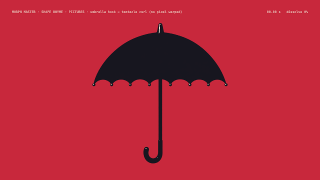 | **MM97 · picture match cut.** Both pictures are restyled into one palette. The hook's outline flows into the tentacle curl (signed-distance morph), and the other tentacles ripple out; the picture swaps only when the outlines are identical. |
|  | **MM95 · text → picture.** An FPV dive into the O of MORNING comes out of the sun. |
| 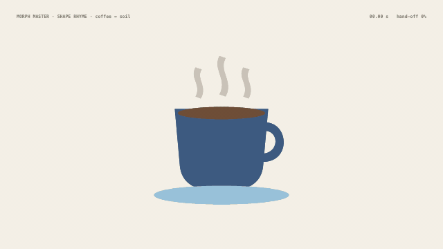 | **MM96 · SVG → SVG.** Coffee surface ↔ soil; the neighbouring parts morph around it. |

**3D models (M5).**

| | |
| --- | --- |
| 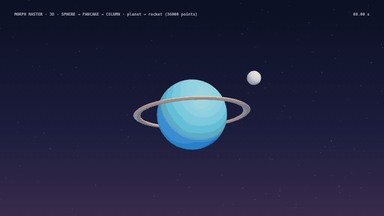 | **MM94 · sphere → pancake → column.** Seen from above, the planet becomes an exhaust plume, and the rocket grows out of it as one continuous front. |
| 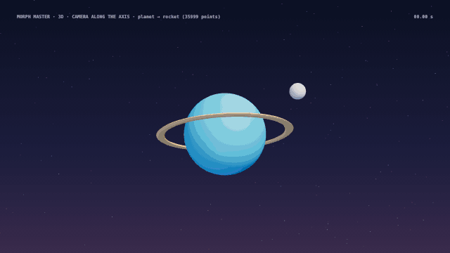 | **MM93 · matching view.** Seen along its axis, the rocket's tail is a circle, like the planet. |
| 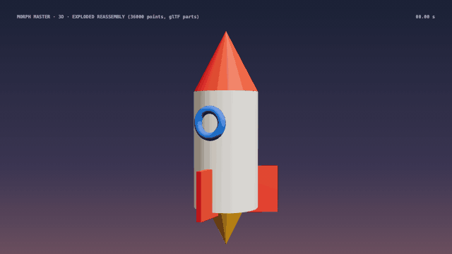 | **MM17 · exploded reassembly.** glTF parts fly out, reshape, and fly back in. |

**Vector, text and parts (M1–M3).**

| | |
| --- | --- |
| 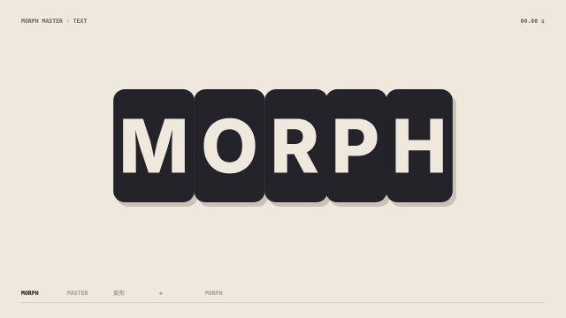 | **MM03 · letter by letter.** Keep, swap, born; stagger, bounce; text ↔ icon. |
| 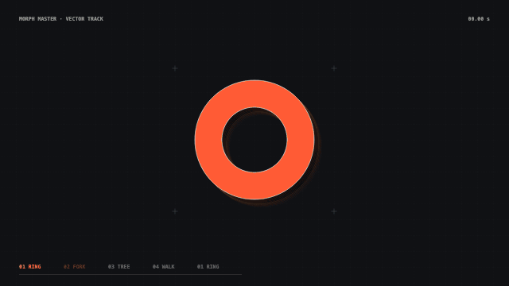 | **MM02 · icon loop.** Pins, sequences, echo, holes. |
| 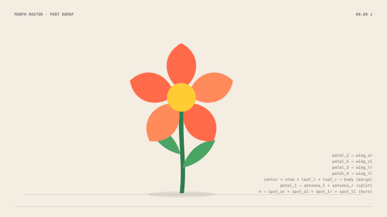 | **MM04 · semantic part remap.** Written as data (`morph.json`), with a cause before and a payoff after. |
| 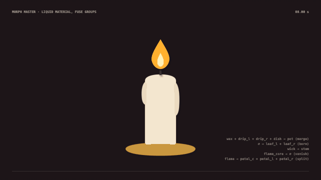 | **MM10 · flat liquid.** Vector geometry rendered through the SDF part field. |
| 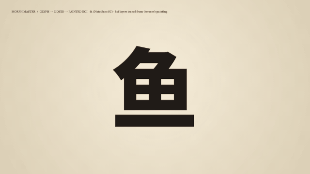 | **MM09 · hanzi → painted koi.** Traced painting layers. |

**Bitmaps and photos (M4).**

| | |
| --- | --- |
|  | **MM12 · pixel particles.** The landing order follows an organic field, so no rectangles appear. |
|  | **MM13 · two-faced shatter and grid tile flip.** |
| 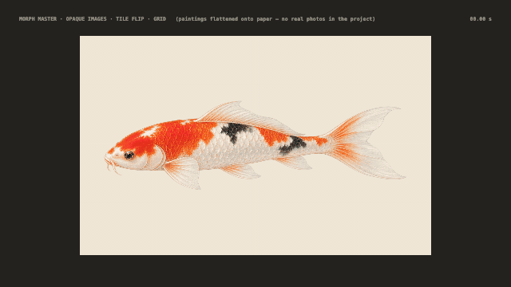 | **MM14 · photo route.** Grid flip, then ink reveal, then blinds. |
| 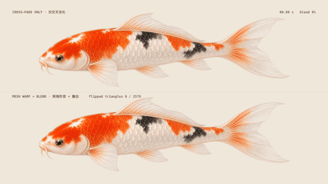 | **MM15 · texture mesh warp.** A cross-fade compared with warp + blend. |

## Strengths and limits

[references/capabilities.md](references/capabilities.md) maps what works well, with the demos behind each rating, what doesn't, and what hasn't been tested. The short version:

- **Strong:** text, icons and man-made objects, shape rhymes you design, flat 2.5D camera shots, layered paintings, and 3D models with named parts.
- **Weak:** creatures drawn from scratch as SVG. Ask for reference art instead.

## The ideas that matter (all learned from measured failures, see the M-reports)

- **Diagnose first.** Every material has its own menu. A photo has no outline, so never promise a photo subject → subject warp; a match cut can still carry it.
- **Every part gets exactly one fate**: morph, split, merge, be born or vanish. Pair parts by meaning, and give every leftover a story.
- **Every transition needs its in-between.** Similar is not identical: morph until the shapes ARE identical, then swap.
- **Rhymes need the same shape and the same colour.** Design both ends, or restyle both into one palette.
- **A camera move is a change of viewpoint** (3D, parallax), not zooming a flat picture. Overlap every step, keep something moving, and make the move decisive: short gather, long fast stretch, hard brake, then swap inside a hide moment.
- **Verify three claims separately:** it builds, frames are deterministic when seeking, and nothing pops at 60 fps. Then look at dense frames yourself.

## Run it

```bash
npm install
npm run dev        # player at http://127.0.0.1:5173 — the MM scenes are listed first
npm test           # 94 tests
npm run build && npm run export -- mm-drone-rhyme --html-only   # one offline HTML file in gallery/
```

## Status and known limits

- Not yet tested on real photographs or real-world glTF files (textures, skins).
- MM95 and MM96 still use the 2D in-frame camera, and MM93 and MM94 use older chained moves; only MM98 uses the full drone camera.
- Picture rhymes need source pixels: a 90 px detail in a 1920 px picture allows about 40 % frame fill before it softens.
